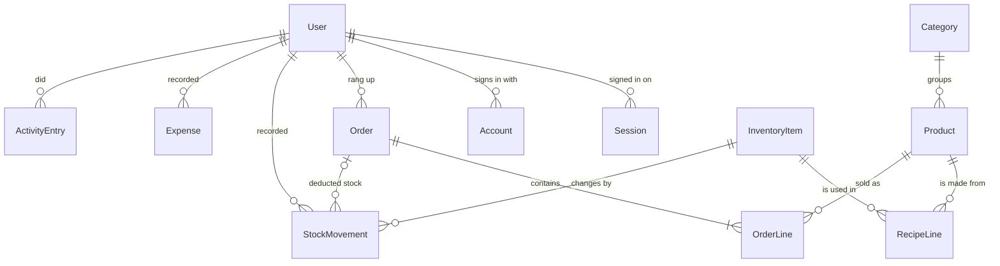
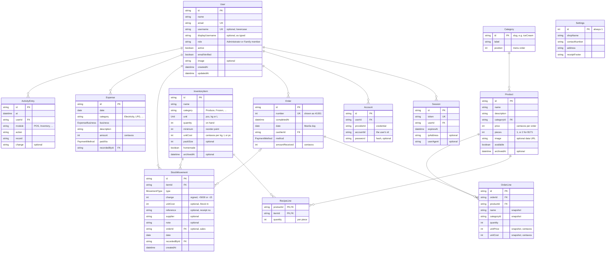

# BunTrack database schema

The tables in `prisma/schema.prisma`, how they connect, and what happens to related rows on delete.

**Status:** the sign-in tables (User, Session, Account, Verification, RateLimit, LoginAttempt) are live on Neon. The 10 app tables are a **draft, not migrated yet**.

- 16 tables (10 new for the app, 6 for sign-in) and 4 enums
- Money is whole **centavos** (₱149.00 = `14900`); stock quantities are the item's **small unit** (pc, g, ml)

> Preview this file in VS Code with `Ctrl+Shift+V` (Mermaid diagrams render in the preview) or on GitHub.

## How the tables connect

Read each line from the "one" side to the "many" side: one category has many products.

- `||--o{` one to zero-or-more
- `||--|{` one to one-or-more
- `|o--o{` optional one to zero-or-more

Not linked to anything: `Settings` (one row), `Verification` (Better Auth), `RateLimit` (Better Auth's request counters), `LoginAttempt` (the login form's lock).

## Every column

`PK` primary key, `FK` points at another table, `UK` unique. Quoted notes mark optional columns or units.

## Relationships and delete rules

**Cascade** deletes the related rows too. **Restrict** refuses the delete while related rows exist, which protects history. The app archives products and items and deactivates people, so these rules are a safety net.

| One | Many | Through | If the "one" is deleted | Why |
|---|---|---|---|---|
| User | Session | `userId` | Cascade | A removed account's sign-ins go with it. |
| User | Account | `userId` | Cascade | The password hash belongs to the person. |
| User | Order | `cashierId` | Restrict | Past sales keep their cashier. Deactivate people instead. |
| User | StockMovement | `recordedById` | Restrict | The stock history says who moved what. |
| User | Expense | `recordedById` | Restrict | Same, for expenses. |
| User | ActivityEntry | `userId` | Restrict | The log can't lose its "who". |
| Category | Product | `categoryId` | Restrict | A category in use can't be deleted (Settings already blocks it). |
| Product | RecipeLine | `productId` | Cascade | A recipe means nothing without its product. |
| InventoryItem | RecipeLine | `itemId` | Restrict | An ingredient can't vanish from a recipe that uses it. |
| InventoryItem | StockMovement | `itemId` | Restrict | The ledger stays complete; archive the item instead. |
| Order | OrderLine | `orderId` | Cascade | Lines are part of the order (orders are never deleted in the app). |
| Product | OrderLine | `productId` | Restrict | Sold products are archived, so receipts and reports stay correct. |
| Order | StockMovement | `orderId` (optional) | Restrict | Only sales have an order; Stock In, waste and adjustments leave it empty. |

## Decisions to check

| Decision | Example | Why |
|---|---|---|
| Money is whole centavos | ₱149.00 → `14900` | Totals never pick up rounding errors. |
| Stock in small units | 2.5 kg onions → `quantity 2500, unit kg` | Repeated small deductions (15 g of lettuce) never drift. |
| Order lines are snapshots | `unitPrice 16900 · unitCost 7420` | Editing a product later never rewrites past revenue or profit. |
| Stock is a ledger | `+5000` Stock In · `-15` sale #1043 | Every change is a row that's never edited; `quantity` is the running total, updated in the same transaction. |
| Archive, don't delete | `archivedAt` set → hidden from menus | Orders, recipes and the ledger point at products and items. |
| "Who" links to the account | `cashierId` → `User.name` | A renamed family member shows their current name everywhere. |
| Order numbers from 1001 | `#1001`, `#1002`, … | A database sequence, so two tills can't take the same number. |
| Some lists stay text | category `"Ice Cream (Dan Eric)"` | Names with spaces and slashes can't be enum values; the app checks them with zod. |

## Enums

| Enum | Values |
|---|---|
| `Unit` | `pcs`, `kg`, `L` |
| `MovementType` | `stock-in`, `adjustment`, `waste`, `sale` |
| `PaymentMethod` | `cash`, `gcash` |
| `ExpenseBusiness` | `burger`, `iceCream`, `shared` |
